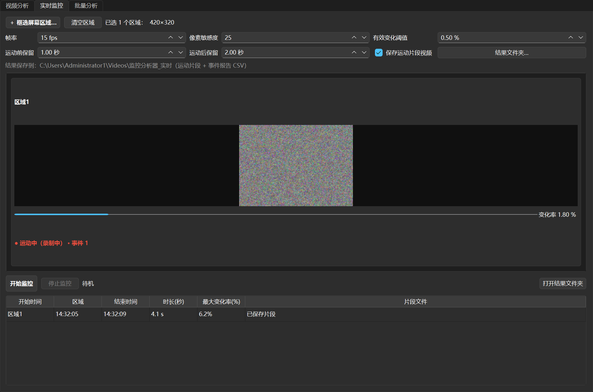

# Video Active Frame Deleter

[简体中文](README.md) | English

A Windows tool that removes static (useless) frames from video footage and keeps
only the segments with real motion, producing a condensed video plus reports.

> Note: the application UI (and the Chinese README) uses Chinese; this document
> describes everything in English. All user-facing texts of the program itself
> are in Chinese.



**Download the portable build**: no Python installation needed — grab
`MonitorAnalyzer_portable_v1.7.0.zip` from the
[Releases](../../releases) page, unzip anywhere and run `监控分析器.exe`.

## Features

- **Input videos**: mp4 / avi / mkv / mov / ts / flv / wmv / webm (any format
  OpenCV supports).
- **Analysis regions**: drag rectangles directly on the preview frame to select
  the **only areas that participate in motion analysis** (multiple allowed) —
  e.g. a gate or a lane. **Without any region the whole frame is analyzed.**
  Fixed overlays such as on-screen time numbers can be left outside the
  rectangles and are automatically ignored.
- **Two-level thresholds**:
  - *Pixel sensitivity (0-255)*: how much a single pixel must change to count as
    "changed" (default 25);
  - *Effective change threshold (%)*: how much of the analysis region must have
    changed for a frame to count as a "motion frame" (default 0.5%).
- **Segment merging**: extra frames are kept automatically before the start and
  after the end of each motion segment (adjustable), and two nearby motion
  segments are merged to avoid fragmented output.
- **Output**:
  - The condensed video (default `<original>_剔除后.mp4`; falls back to
    AVI/XVID automatically when the codec is unavailable);
  - Optional **burned-in original timestamp watermark** on output frames
    (removing frames compresses the timeline; the watermark preserves the
    original moment);
  - CSV report (time, change ratio and keep flag per frame, UTF-8 BOM — opens
    directly in Excel);
  - Optional: save the kept frames as images.
- **Background analysis** with progress bar, live statistics and live preview
  (current frame + changed pixels marked in red), cancelable at any time.
- **Multithreaded chunking**: long videos are automatically split and analyzed
  in parallel (default "auto" = CPU core count, up to 8 threads; manual 1-32,
  1 = sequential mode). Results are identical to the sequential mode.
- **Preview before saving**: after the analysis the result video plays in a
  built-in player (play/pause, seek); press **Save result…** to choose the
  destination — video, CSV report and kept-frame images are saved together.
  Or discard the result with one click.

### Live video tab (new)

The second tab: **analyzes screen regions in real time** (multi-monitor,
multiple regions, each region analyzed independently with its own results) —
for watching IP-camera web pages, video streams, live feeds, etc.

- Click **框选区域** (select regions) to enter the full-screen overlay, with
  **two-level selection**:
  1. **Video region** (green frame, the capture/recording range): drag one
     rectangle, it is set as soon as you release the mouse; **press A to draw
     the next region, press Enter to finish** (Esc cancels everything /
     right-click a rectangle to delete it);
  2. **Press S to switch to analysis regions** (blue frame, only changes inside
     these sub-regions count for motion detection — leave time numbers outside):
     same keys; analysis rectangles are clipped to their video region
     automatically; **no analysis region = the whole video region is analyzed**.
     A hint bar shows the current keys;
- One card per region: live preview, current change ratio and status;
- A change ratio staying above the threshold is recorded as a **motion event**:
  start/end time, peak/average ratio; with "save motion clips" checked, every
  event is stored as an mp4 clip (otherwise only the CSV is written);
- **Merge output**: when stopping, **all clips of each region are automatically
  merged into one video** (`区域N_合并_时间戳.mp4`, concatenated in event order);
- Stopping also generates `事件报告_时间戳.csv` (default folder
  `视频\监控分析器_实时`, changeable);
- Parameters: sampling fps (default 15), pixel sensitivity, effective change
  threshold, seconds kept before/after each event.

### Batch tab (new)

The third tab: **analyze many videos at once** ("添加视频" / "添加文件夹").

- **Per-video analysis regions**: double-click a row to open a region editor
  for that video (frame stepping, multiple rectangles; leave fixed overlays
  outside). The row then shows **已编辑 N 个区域** (N regions edited); videos
  without regions are analyzed **full-frame**;
- One row per video with live status/progress/result; "simultaneous analyses"
  1-4 (default 2); above 1 each video internally switches to single-thread to
  avoid CPU contention;
- Double-click the result cell to open the output file when finished; hover a
  failed row for the reason; cancel all with one button;
- Output names match the single-video mode (`<original>_剔除后.mp4`), saved
  next to each video by default or in one chosen folder; CSV report and
  timestamp watermark are optional.

## Usage

1. Run `run_dev.bat` (dev checkout) or unzip the portable package and run
   `监控分析器.exe`;
2. Click **选择视频…** and load your video;
3. **Drag analysis regions** on the preview (only the inside of the rectangles
   is analyzed; none = full frame);
4. Set **pixel sensitivity** and **effective change threshold (%)**, adjust
   kept frames and threads as needed;
5. Click **开始分析** and wait for the progress to finish;
6. Preview the result in the built-in player, then **保存结果…** to export
   (video + CSV + kept-frame images saved together) or **放弃结果** to discard.

The live video and batch tabs are switched at the top of the main window; all
follow "configure → start → check results".

## Suggested parameters

| Scenario | Pixel sensitivity | Effective change threshold |
|---|---|---|
| Daytime, clean footage | 20-30 | 0.3 - 1 % |
| Night, noisy | 35-50 | 0.5 - 2 % |
| Only large motion (people/vehicles) | 25-40 | 2 - 5 % |

## Performance

Three speed-ups built in since v1.2, all enabled by default:

- **Seek-based export**: decodes only the kept segments, skipping all motion-free
  ranges — the more frames are dropped, the faster.
- **Multithreaded chunking**: long videos are analyzed in parallel segments
  (thread count "0 = auto").
- **Fast mode (optional, off by default)**: videos wider than 1280 px are
  downsampled before analysis — much faster, but tiny/faint targets (a distant
  flame, small animals) may be missed; larger targets (pedestrians, vehicles)
  are unaffected.

Measured reference (i9 32 threads, 1920x1080@25fps, including export and
watermark):

| Material | v1.1.1 | v1.2 |
|---|---|---|
| 11-second clip (281 frames) | 3.4 s | 3.1 s |
| 5-minute video (7500 frames, 10% kept) | 67 s | **32 s** |

## Building the portable package

Requires Python 3.14 (the `py` launcher). Run in the project root:

```bat
build.bat
```

Pipeline: create `.venv` → install dependencies → run unit tests →
PyInstaller bundle → compress to `dist\监控分析器_portable.zip`.

The portable package is installation-free: unzip anywhere and run
`监控分析器.exe`.

## Development

```bash
# Windows + Python 3.14 (3.10+ should work too, not exhaustively verified)
pip install -r requirements.txt
python main.py            # run
python main.py --selftest # self-test (built-in synthetic video end-to-end)
python -m unittest discover -s tests -v  # unit tests
.\build.ps1               # portable zip (PyInstaller → dist\监控分析器_portable.zip)
```

## Code layout

```
app/core/analyzer.py     analysis engine (masks / change ratio / segment state machine / run_analysis / worker threads)
app/core/live_monitor.py live video engine (mss screen capture / per-region state machine / event clips)
app/core/video_io.py     video metadata and timestamp helpers
app/core/report.py       CSV report
app/ui/roi_canvas.py     preview canvas (mouse-selected analysis regions)
app/ui/live_tab.py       live video tab
app/ui/batch_tab.py      batch tab
app/ui/screen_select.py  full-screen overlay region selection
app/ui/main_window.py    main window (three tabs)
tools/make_test_video.py synthetic test video generator
tests/                   unit tests + end-to-end tests
```

## FAQ

- **The output video is much "shorter" than the source?** Removing frames
  shortens the duration at the same fps; the timestamp watermark on output
  frames shows the original time.
- **Motion segments missed?** Lower the "effective change threshold" or the
  "pixel sensitivity" and retry.
- **Static frames kept in large numbers?** Usually night or compression noise:
  raise the pixel sensitivity, or select analysis regions that cover only what
  matters (keep the sky, treetops etc. outside).
- **Preview blank / cannot read frames?** Usually a codec the system lacks
  (some H.265/HEVC or unusual containers). Confirm the video plays in a player;
  if it does but this tool cannot read it, convert to H.264 MP4 first.
- **Long video slow?** Keep "parallel threads" at 0 (auto) for chunked
  parallel analysis; on HDDs copy the video to a local disk first.

## Changelog

- **v1.7**: live video upgraded to **two-level selection** — inside each video
  region (green) you can now draw **analysis regions** (blue), so only changes
  inside the sub-regions count for motion detection (leave time numbers
  outside); **press S** to switch between the two modes; analysis rectangles
  are clipped to their video region automatically; no analysis region = the
  whole video region is analyzed.
- **v1.6**: two live upgrades — ① region drawing now sets one region at a
  time: release the mouse to set it, **A** draws the next, **Enter** finishes,
  with on-screen key hints; ② new **merge output** option: when stopping, all
  clips of each region are merged into one video.
- **v1.5**: batch supports **per-video analysis regions** — double-click a row
  to open the editor (frame stepping, multiple rectangles); the row shows
  "N regions edited"; videos without regions are analyzed full-frame.
- **v1.4.1**: two fixes — ① opening a new video without saving the previous
  result left stale region rectangles on the canvas; ② the bottom-right live
  preview panel grew by 2 px on every frame (ratchet) and never shrank back.
- **v1.4**: new **live video** and **batch** tabs. Live: select any screen
  regions (multi-monitor), independent analysis per region with live preview
  cards, motion-event CSV, optional automatic mp4 clips. Batch: add many
  videos (files or folders), 1-4 concurrent analyses with per-row
  progress/status/result and one-click cancel.
- **v1.3**: ① "exclusion region" became the more intuitive "**analysis
  region**" — only the inside of the rectangles is analyzed (none = full
  frame); ② the live preview upgraded to current frame + changed pixels marked
  red (instead of the dark difference mask); ③ fixed statistics text and
  preview freezing on long videos (time-throttled updates).
- **v1.2**: major speed-up — seek-based export of kept segments only,
  multithreaded chunking (automatic for long videos), optional fast
  downsampled mode (off by default); the progress bar shows processing speed.
- **v1.1**: fixed "cannot analyze twice"; added multithreaded chunking;
  results are now previewed in-app and saved manually (no direct writing);
  videos are verified as decodable when opened with a clear error; failed
  frame reads retry with a fallback.
- **v1.0**: first release.

## License

[MIT](LICENSE)
